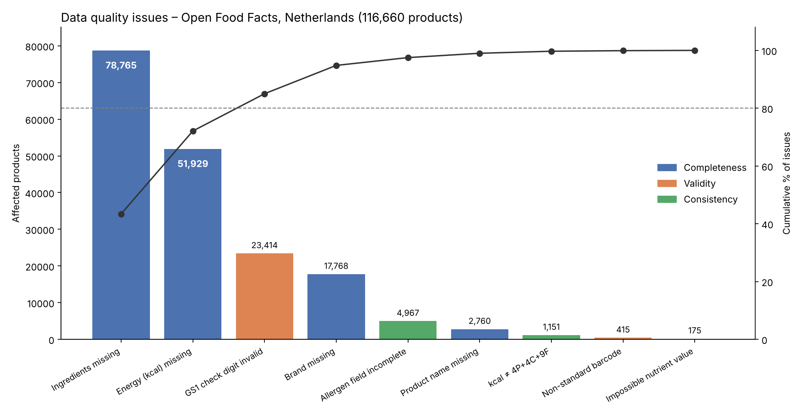

# Food Product Data Quality Audit — Open Food Facts (Netherlands)

A SQL-based data quality audit of **116,660 food products** sold in the Netherlands, using the public [Open Food Facts](https://world.openfoodfacts.org/) database.

The aim was to answer three questions a data quality team would ask about a product catalogue:

1. **How complete, valid and consistent is the data?**
2. **Where do most of the issues come from?** (Pareto analysis)
3. **What is the root cause of the largest validity issue, and what would prevent it?**

**Tools:** DuckDB (SQL) · DBeaver · Excel/Numbers
**Skills shown:** data profiling, data validation rules, GS1 barcode validation, root-cause analysis, Pareto analysis, domain-based rule design (food science)

---

## Key findings

| Dimension | Issue | Affected products | % of products | Cumulative % of issues |
|---|---|---:|---:|---:|
| Completeness | Ingredients missing | 78,765 | 67.5% | 43.4% |
| Completeness | Energy (kcal) missing | 51,929 | 44.5% | 72.1% |
| Validity | GS1 check digit invalid | 23,414 | 20.1% | 85.0% |
| Completeness | Brand missing | 17,768 | 15.2% | 94.8% |
| Consistency | Allergen field incomplete | 4,967 | 4.3% | 97.5% |
| Completeness | Product name missing | 2,760 | 2.4% | 99.0% |
| Consistency | kcal ≠ 4P+4C+9F | 1,151 | 1.0% | 99.7% |
| Validity | Non-standard barcode | 415 | 0.4% | 99.9% |
| Validity | Impossible nutrient value | 175 | 0.2% | 100% |

**Summary**

- **Three issues make up 85% of all issues** found: missing ingredients, missing energy values and invalid barcodes.
- **The main problem is missing data, not wrong data.** Where nutrient data exists, it is largely reliable: 98.2% of energy values match the macronutrients, and only 0.2% of products have physically impossible values.
- **Volume is not the same as risk.** Allergen gaps affect only 4.3% of products, but they are the most important issue from a food safety point of view. I would prioritise:
  1. allergen gaps (consumer safety),
  2. the bulk-import barcode issue (one root cause, large effect),
  3. completeness of ingredients and nutrition data.

---

## Method

The checks follow four common data quality dimensions:

| Dimension | Check | Rule |
|---|---|---|
| Completeness | Filled fields | Share of non-empty values per field |
| Uniqueness | Barcodes | No duplicate or empty barcodes |
| Validity | Barcode format | EAN-13 / EAN-8 / other / non-numeric |
| Validity | GS1 check digit | Last digit must match the GS1 weighted sum (3,1,3,1… from the right) |
| Validity | Nutrient plausibility | No negative values; no nutrient > 100 g per 100 g; energy ≤ 900 kcal; sugars ≤ carbohydrates; saturated fat ≤ fat |
| Consistency | Energy | Declared kcal vs 4 × protein + 4 × carbohydrates + 9 × fat (tolerance: max of 20 kcal or 20%) |
| Consistency | Allergens | Allergen keywords in the ingredients list (Dutch + English) must also appear in the allergen fields |

All issues are collected in an **issue log table** (`dq_issues`: one row per product per issue), which is then summarised with a Pareto analysis.

---

## Detailed results

### Completeness

| Field | Filled |
|---|---:|
| Product name | 97.6% |
| Brand | 84.8% |
| Energy (kcal) | 55.5% |
| Ingredients | 32.5% |
| Allergens (`allergens`) | 2.4% |
| Allergens (`allergens_en`) | 18.8% |

### Uniqueness
All 116,660 barcodes are unique and none are empty. ✅

### Validity: barcodes

| Barcode type | Products | Invalid check digit |
|---|---:|---:|
| EAN-13 | 89,526 (76.7%) | 1,585 (**1.77%**) |
| EAN-8 | 26,719 (22.9%) | 21,829 (**81.7%**) |
| Other length | 415 (0.4%) | n/a |

An error rate of 1.77% for EAN-13 is realistic for manual entry errors. **81.7% for EAN-8 is not**, so I looked at it more closely (see root-cause analysis below).

### Validity: nutrient plausibility

| Rule | Violations |
|---|---:|
| Negative value | 0 |
| Nutrient > 100 g per 100 g | 27 |
| Energy > 900 kcal per 100 g | 36 |
| Sugars > carbohydrates | 81 |
| Saturated fat > total fat | 41 |
| Fat + carbs + protein > 105 g | 24 |

Violations are rare (< 0.1%), but each one is a certain error and could be blocked by a simple validation rule at data entry.

### Consistency: energy
- 63,046 products had all values needed for the check.
- **61,895 (98.2%) were consistent** within tolerance, and 1,151 (1.8%) were not.
- **28 products** had a declared value about 4.2 times the calculated one. This is the kJ/kcal conversion factor, so these are probably **kJ values entered in the kcal field**.

### Consistency: allergens

| Allergen | Found in ingredients | Not declared in allergen fields | % |
|---|---:|---:|---:|
| Milk | 12,050 | 2,730 → **2,331** after false-positive removal | 19.3% |
| Gluten | 10,918 | 1,452 | 13.3% |
| Soy | 6,819 | 1,243 | 18.2% |
| Egg | 3,168 | 805 | 25.4% |
| Tree nuts | 1,944 | 231 | 11.9% |
| Peanut | 1,588 | 457 | **28.8%** |

Peanut has the highest gap. Because peanut allergy can cause severe reactions, this is the highest-priority finding.

---

## Root-cause analysis

### 1. Invalid EAN-8 barcodes: a bulk import, not typing errors

**First hypothesis:** the codes are retailer-internal codes from a few brands.
**Result: not supported.** A Pareto by brand showed no concentration: the top 15 "brands" explained only 18% of invalid codes. Many "brands" were ordinary Dutch words (*dames*, *heren*, *mini*, *luxe*).

**Next step:** a random sample of 30 invalid records. This showed four patterns:
- codes starting with `00` (e.g. `00487256`),
- the code repeated in the product name (e.g. *Dames jeans-0487256*),
- the brand field filled with the first word of the product name,
- non-food items (jeans, LED lamps, window wipers) and no category.

**Testing the patterns against a control group (valid EAN-8 codes):**

| Pattern | Invalid EAN-8 | Valid EAN-8 |
|---|---:|---:|
| Starts with "00" | **76.9%** | 32.6% |
| Code appears in product name | **29.4%** | 11.8% |
| Brand = first word of product name | **89.2%** | 45.9% |
| No category | **99.2%** | 62.2% |

**Conclusion:** most invalid 8-digit codes are consistent with a **bulk import of retailer article numbers**, not with random typing errors. The brand field also appears to have been auto-filled from the product name.

*Notes:*
- A random 8-digit number passes the check-digit test about 10% of the time by chance, so part of the "valid" group is probably from the same import. This explains why the valid group also shows these patterns.
- "Brand = first word" is a weak signal on its own, because real product names often start with the brand. The strongest signals are the `00` prefix and the missing category.

### 2. Allergen check: verifying the right field before reporting

My first allergen check showed **~90% of allergens missing**. Before reporting this, I checked whether I was using the right field. A second column, `allergens_en`, was **8× more complete** (18.8% vs 2.4%). Re-running the check on both fields reduced the gap to **12–29%**, a very different conclusion.

### 3. Food-domain false positives

Simple keyword rules can raise false alarms. For milk, the rule also matched:
- *cacaoboter* (cocoa butter): contains "boter" (butter)
- *pindakaas* (peanut butter): contains "kaas" (cheese)
- *kokosmelk*, *havermelk*, *amandelmelk* (plant-based drinks)

Removing these reduced the milk alerts from 2,730 to **2,331 (−14.6%)**.

---

## Recommendations

1. **Allergen gaps first:** if the ingredients contain a known allergen keyword, require the allergen field to be filled before a product is published.
2. **Validate barcodes at entry:** reject codes that fail the GS1 check digit. Review or tag the source of the bulk import that loaded retailer article numbers.
3. **Simple plausibility rules:** block nutrient values > 100 g per 100 g, energy > 900 kcal, sugars > carbohydrates, and warn when kcal ≈ 4.2 × the calculated value (probable kJ entry).
4. **Completeness:** focus on ingredients and nutrition data, which make up 72% of all issues.

---

## Limitations

- Open Food Facts is **crowd-sourced**, so the results describe this database, not the products themselves or their real labels.
- Allergen detection uses **keyword matching** in Dutch and English. It can still miss allergens (other languages, unusual names) or raise false alarms. "May contain" (traces) information was not included.
- Tolerances (20% for energy, 0.5 g for sugars and fats) are my own choices. Other tolerances would give slightly different numbers.
- Country filter: products tagged `en:netherlands` (sold in the Netherlands), as of November 2026.

---

## How to reproduce

1. Download the full CSV export from Open Food Facts: `en.openfoodfacts.org.products.csv.gz` (~0.9 GB).
2. Open DuckDB (e.g. in DBeaver) and change the file path in section 0 of [`dq_checks.sql`](dq_checks.sql).
3. Run the sections in order. Loading takes under a minute; every check runs in seconds.

## Files

| File | Content |
|---|---|
| `dq_checks.sql` | All SQL: loading, checks, root-cause queries, issue log, Pareto |
| `dq_pareto_results.csv` | Pareto summary table (exported from DuckDB) |
| `pareto_dq_issues.png` | Pareto chart |

---

*Data: Open Food Facts, licensed under the [Open Database License (ODbL)](https://opendatacommons.org/licenses/odbl/1-0/).*
